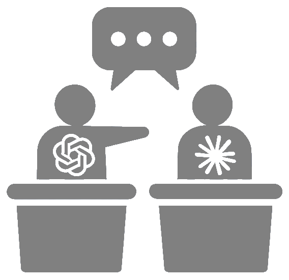

<p align="center">
  
</p>

<h1 align="center">ArgueBot</h1>

<p align="center"><strong>Put agents in conversation, challenge their answers, and keep the history.</strong></p>

ArgueBot runs structured debates between a configurable panel of agents and supports follow-up questions to individual agents. Its C# TUI and React web dashboard share one persistent service, so you can switch interfaces without losing conversations or stopping accepted work. A scriptable C# CLI uses that same service.

Agents can run Claude Code, Codex, Gemini CLI, Mux, another CLI program, or REST models through PolyPrompt. REST participants can execute local file and process tools on the service machine. Agent-declared consensus is recorded as an outcome, not treated as proof that the answer is correct.

## About v2.0.0

**v2.0.0 is a complete rewrite of ArgueBot.** The original Node.js prototype (version 0.1.0, run through npm) let two or three CLI agents debate and detected agreement from keywords. Version 2.0.0 replaces it with a C# service, a terminal interface (TUI), a React web dashboard and a scriptable CLI that all share one persistent workspace. The npm commands are retired.

What v2.0.0 does:

- **Multi-agent debates.** A panel of 2 to 16 agents (configurable up to 64): Claude Code, Codex, Gemini CLI, Mux, a generic CLI, or REST models served through Ollama or an OpenAI-compatible endpoint. An orchestrator asks one focused question per round, the agents respond, the orchestrator proposes an answer and every agent votes. Agreement requires an explicit "agree" from every active agent on the same proposal; disagreement stays visible.
- **You moderate.** Add context for everyone or privately for one agent, either immediately or at the next turn; pin constraints; edit the proposal under vote; add, remove or replace agents between turns; pause, resume, interrupt, extend or stop.
- **Long debates stay grounded.** The orchestrator keeps a source-linked working memory, and agents use built-in tools to page through turns, search the conversation, check evidence and ask you for clarification. Original turns are never discarded.
- **Editable prompts.** Each debate step's instructions come from a prompt library. Factory defaults are read-only; duplicate one to change it, using `{parameters}` such as `{question}`, and choose prompts per conversation.
- **Reusable configuration.** Agents, models, HTTP endpoints and encrypted secrets (Claude Code tokens, Codex logins, bearer, header and query API keys) are defined once and reused. Execution budgets, timeouts and output limits are set per run.
- **Readable results.** Watch a debate live in a compact timeline, then read it as a full-page transcript with rounds, the final proposal and each agent's vote. Export as Markdown or print to PDF.
- **One service, many interfaces.** The service owns the database (SQLite by default, PostgreSQL optional) and keeps running when you close an interface. The TUI, dashboard, CLI, REST API and Docker image all use it.

**v2.2.0 (in development on `feature/v2.2.0`)** adds resources: named markdown documents in your workspace that agents can list, search, read and, when you allow it, write during a debate. A role instruction can say "if you need to know more about billing, call `read_resource` with name `billing`", and the agent pulls that context in only when it needs it. See [Resources](#resources) and the [resources guide](docs/RESOURCES.md).

**v2.1.0** added sign-in, users, tenants, bearer-token credentials, an audit log and time-limited public share links. See [Sign-in, users and tenants](#sign-in-users-and-tenants).

**Status:** v2.0.0 is an implementation preview on `main` and has not been published as a release. Distribution builds are local artifacts: Windows packages are unsigned and macOS bundles are ad-hoc signed and not notarized. Databases from earlier v2 previews upgrade automatically on startup, with a backup first. See the [CHANGELOG](CHANGELOG.md) for details, the [debate guide](docs/MULTIPLE_AGENTS.md), [prompts](docs/PROMPTS.md), the [model tools](MCP_API.md), the [Docker guide](docker/README.md) and [packaging](packaging/README.md).

If the operating system blocks a downloaded build, review the source and checksum first. Then on Windows choose **More info > Run anyway**, and on macOS choose **Privacy & Security > Open Anyway**.

## Getting started

The launchers build with any installed .NET SDK, version 8 or newer, that can target the selected framework. Verification and packaging use the SDK pinned in [global.json](global.json). Building the web dashboard also requires Node.js 24 and npm; the terminal interface does not require npm. The shared library/test matrix also uses .NET 8.

Clone the repository and choose an interface:

| Interface | macOS / Linux | Windows |
| --- | --- | --- |
| Terminal | `./go-tui.sh` | `go-tui.bat` |
| Web dashboard | `./go-web.sh` | `go-web.bat` |
| Stop service | `./stop-web.sh` | `stop-web.bat` |

`stop-web` shuts the service down, which needs a system administrator: sign in once with the CLI's `login` (the session is remembered for that home), or set `ARGUEBOT_TOKEN`.

Both launchers build before running. The web launcher installs dashboard dependencies when needed, starts or attaches to the selected service, and prints the URL to open in your browser. The default URL is <http://127.0.0.1:4317/dashboard>. Re-running it reuses the service for that application home.

Each launcher accepts an optional target framework as its first argument, `net8.0` or `net10.0` (the default). For example, `./go-tui.sh net8.0` or `go-web.bat net8.0 --port 4417` builds and runs the .NET 8 build. A `net8.0` build needs SDK 8 or newer and runs on the newest installed runtime when .NET 8 itself is absent, so a machine with only .NET 9 can use `net8.0`. `net10.0` needs SDK 10.

Every interface asks you to sign in. A new service starts with a default administrator, **`admin@arguebot`** with password **`password`**, and a default bearer token **`arguebotadmin`**. The sign-in pages always show them. Change the password after you first sign in. Docker and external telemetry services are not required.

### Choose an application home

Conversations, configuration and logs live in `~/.arguebot` by default. Use the same home in both interfaces to work with the same data:

```sh
./go-tui.sh --home .run/my-workspace
./go-web.sh --home .run/my-workspace --port 4417
./stop-web.sh --home .run/my-workspace
```

A port override applies when starting a service. Attaching to an existing service uses its actual listener address. `--server URL` connects to an explicit service. The service owns its home and database exclusively; clients never write the database directly.

## Sign-in, users and tenants

ArgueBot 2.1 requires a signed-in user for everything except the sign-in page, health checks and public share links.

- **Signing in.** The dashboard opens at `/dashboard/login`, the TUI opens a sign-in page that also asks for the server URL, and the CLI uses `login`. You can sign in with an email and password, or with a bearer token. Sessions last 60 minutes and the interfaces refresh them while you work.
- **Tenants.** A tenant is a separate workspace: its own users, conversations, agents, secrets and prompts. Everyone in a tenant shares its data. Tenants never see each other's data. The **Default tenant** holds everything created before 2.1. If your email and password work in more than one tenant, the sign-in page asks which one.
- **User types.** A **system administrator** manages everything, including tenants, service settings and encryption keys, and can manage the users of any tenant. A **tenant administrator** manages the users, tokens, sessions, request history and audit log of their own tenant. A **user** works with the tenant's conversations and configuration and manages only their own account. The default administrator, default tenant and default token are protected: they cannot be deleted or disabled.
- **Bearer tokens.** Create credentials for scripts and tools on the dashboard's Account page, in the TUI Menu or with `credentials create`. Reveal shows a token again later (audited). Send it as `Authorization: Bearer <token>`, as `x-token`, with the CLI's `--token` or as `ARGUEBOT_TOKEN`.
- **Secrets.** Provider keys and logins for agents, which earlier versions called credentials, are now **secrets** (Participants > Secrets, `secrets` in the CLI, `/v2.0/api/configuration/secrets`). The old names still work in 2.1.x.
- **Audit log.** Sign-ins, sessions, token changes, user and tenant changes and every denied request are recorded. Administrators review it on the Audit log page, in the TUI Menu or with `audit`.
- **Sharing.** **Share** in a conversation creates a read-only public link that expires after 1 hour to 90 days. Anyone with the link can read the transcript and nothing else. Revoke links from the same dialog.

### Reaching the service from another machine

The service accepts the host names `127.0.0.1` and `localhost`. To use another name, such as a reverse proxy or LAN name, add it to `allowedHosts` in `arguebot.json` or set `ARGUEBOT_ALLOWED_HOSTS` (comma-separated), then restart. If you don't know the names in advance, `*` accepts any host name; sign-in still protects everything, so change the default administrator password first. The service itself still listens on `127.0.0.1` unless `listenAddress` is `0.0.0.0`. Passwords and tokens travel with every request, so put the service behind HTTPS (enable TLS in the settings or use a TLS-terminating proxy) before you reach it over a network. The CLI and TUI refuse plain HTTP to a remote server unless you pass `--allow-http` or tick the matching box on the TUI sign-in page. See [docs/IDENTITY.md](docs/IDENTITY.md) and [docs/OPERATIONS.md](docs/OPERATIONS.md).

## Docker

The published image `jchristn77/arguebot` runs the service and dashboard with pinned Claude Code, Codex and Gemini CLIs:

```sh
docker compose -f docker/compose.yaml up -d
```

Add `-f docker/compose.build.yaml` to build from this checkout instead. Maintainers publish the image with `build-all.sh <tag>` or `build-all.bat <tag>`, which build both architectures on the same cloud builder as Armada and push them. See the [Docker guide](docker/README.md) for volumes, environment settings and the trust model.

## Configure participants

Debates seat **agents**. An agent either runs a CLI program (Claude Code, Codex, Gemini CLI, Mux or another program) or runs a reusable model on an HTTP endpoint, and can carry role instructions. A CLI agent has an optional **Secret**: select a stored secret when running in Docker or to override the credentials used by default by the agent. Without one, the program uses the login of the account running the service, which a container does not have. A CLI agent can also name a model, passed to the program as `--model`. Set agents up on the dashboard's **Participants** page (Agents, Models, HTTP Endpoints and Secrets tabs) or in the TUI under Menu > Agents. Each agent's **Check agent** action runs it once to confirm it signs in.

To add an agent, use **Agents** or **Ctrl+E** in the TUI, or **Add agent** on the dashboard's Agents tab.

Choose a named runner type to populate its executable and arguments. Claude Code includes `--dangerously-skip-permissions`; Codex and Mux include `--yolo` so accepted debate turns can run unattended. You can edit the argument rows. Generic CLI requires an executable and any arguments its protocol needs. Each argument row is one literal flag or value, without shell quoting.

Installed CLI programs must be available to the service process and signed in, either with a stored secret on the agent or with their own login. A working directory selects where the program or local tools operate. Do not enter a whole shell command in the executable field.

For a REST participant, choose a provider, endpoint and model. Supported provider formats include Ollama, OpenAI-compatible, Anthropic and Gemini. Configure any credential through the named environment variable available to the service process. ArgueBot does not automatically load a project `.env` file. Restart the service when its environment changes.

CLI agents and REST local tools execute on the service machine, within the configured local-execution policy. Historical run snapshots retain the participant settings used for that run even if you edit the reusable profile later. See [execution behavior](docs/EXECUTION.md).

## Resources

Resources are named markdown documents in your workspace that agents can read during a debate. Instead of pasting background into every prompt, write it once as a resource and point agents at it in a prompt or role instruction:

```text
If you need to know more about billing, call read_resource with name billing.
```

The agent reads the resource only when it needs it. Agents can list and search resources too, and when a debate allows writing they can create resources, edit them and append notes, so later turns and later debates can build on what they found.

- **Names** such as `billing` or `team/conventions` are unique in the tenant. Bodies are markdown up to 256 KiB, with a title, a one-line description and tags.
- **Every change is a revision** with its author (a user, or an agent with its debate run) and time. Saves need the current revision, so nobody overwrites another change by accident. Compare any revision with the current text and restore it.
- **Each debate chooses access**: Read (the default) offers `list_resources`, `search_resources` and `read_resource`; Read and write adds `create_resource`, `update_resource`, `edit_resource` and `append_resource`; Off offers none. A debate can also limit its agents to named or tagged resources, and caps writes per turn and resources created.
- **Locked** resources can be read by agents but never changed by them. Agent-written text is marked as such until a user changes it.
- **Prompts** can list the debate's resources with the opt-in `{resources}` placeholder.

Manage resources on the dashboard's **Resources** page, in the TUI under Menu > **Resources**, with the CLI's `resources` commands or through `/v2.0/api/resources`. Import and export use `.md` files with front matter. See [resources](docs/RESOURCES.md) and the [tool reference](MCP_API.md#resource-tools).

## Terminal interface

Use **Start debate** to enter a question, choose speakers and an orchestrator, set debate options and review before submission. The service runs the debate while the TUI displays committed history and current state.

Useful controls include:

- **F1**: explanatory help for the current context.
- **F2**: action menu.
- **Tab / Shift+Tab**: move focus; **Alt+1 / Alt+2 / Alt+3**: jump between conversations, history and notes.
- In the conversation list, **Enter** opens the highlighted conversation, **s** offers to stop unfinished work, and **d / Delete** offers deletion. Deleting unfinished work offers a combined stop-and-delete flow.
- **Ctrl+B**: configure a debate; **Ctrl+R**: moderator controls; **Ctrl+Y**: follow-up question.
- **Ctrl+L**: full message history; **Ctrl+G**: generation attempts; **Ctrl+T**: theme.
- **Ctrl+Q**: detach. Accepted work continues in the service.
- **Menu > Resources**: read, edit (in a multi-line editor), lock and export resources, and compare and restore revisions.
- **Menu > Account**: who you are signed in as, password, bearer tokens, sessions, sign out and switch server. Administrators also get **Users**, **Audit log** and **Tenants**; with a conversation open, **Share a read-only link**.

After consensus, open moderator controls for final instructions or use a follow-up for a specific participant. Detailed workflows, confirmation behavior and failure recovery are explained in [terminal usage](docs/TUI.md) and the built-in help.

## Web dashboard

The dashboard provides sign-in, conversations, participant configuration, the conversation workspace, request history, API Explorer and service settings.

- **New conversation** asks for a title, shown in the conversation list, and an optional opening question. Starting a debate pre-fills its question from the opening question (or the title when it is blank); you can edit it before the debate starts.
- Click a conversation row to open its workspace; click another editable row to open its editor. Each table's **Actions** column has a menu (for conversations: open, rename, pin, archive, stop debate, view JSON and delete). Copy buttons remain independent.
- **Prompts** lists the instructions each debate step sends. Factory defaults are read-only; duplicate one to edit it, with a legend of the `{parameters}` it can use, then choose it per step when creating a conversation or starting a debate. See [docs/PROMPTS.md](docs/PROMPTS.md).
- **Resources** lists the markdown documents agents can read, with search and tag filters. Add or import `.md` files, edit with a preview, lock a resource so agents cannot change it, and open its history to compare a revision with the current text and restore it. A debate's execution settings choose its resource access, visible resources and write limits, and resource tool calls in the transcript link to the revision they used. See [docs/RESOURCES.md](docs/RESOURCES.md).
- Participants has tabs for agents, models, HTTP endpoints and secrets. Clicking a row in any table opens that item for editing, or shows its details when there is nothing to edit. The Secrets tab explains how to obtain each kind of secret, with copyable commands for macOS, Linux and Windows PowerShell, and can reveal a stored value after confirmation.
- The account menu in the top bar opens **Account** (profile, password, bearer tokens and sessions) and signs out. Administrators also see **Users**, **Audit log** and, for system administrators, **Tenants** and **Settings**.
- **Share** in the workspace header, or in a conversation's Actions menu, creates and revokes read-only public links to the transcript.
- Conversation and participant IDs have dedicated columns, monospace text and copy buttons.
- **Read transcript** (in the workspace header and each conversation's Actions menu) opens the whole conversation as a full-page document: contents by debate and round, the final proposal with every agent's vote, each round's question, responses and vote table, and the moderator's context. Agents keep their colors and can be hidden one at a time, tool calls are folded away unless you show them, every turn folds, and the page copies as Markdown or prints and saves as PDF.
- In the workspace, the default **Timeline** view shows one compact line per turn (agent color, step, vote position, a preview of the text, and the newest text while an agent is still writing), labels each debate round with the service's round number (so a later page or a long debate shows the real round) and folds consecutive tool calls into one row. Click a line to expand it in place; failed turns open automatically. **Cards** shows every turn in full. Both views support Expand all, Collapse all and **Jump to turn**. Copy individual turns or the full conversation; complete content is fetched independently of visible previews.
- Clipboard support includes HTTPS, localhost and other HTTP origins, with a manual selection fallback when the browser blocks clipboard access.
- Diagnostic request rows open an inspector with metadata, request/response captures and copy controls.
- Request activity offers last-hour/day/week/30-day ranges with 60 one-minute, 96 fifteen-minute, 84 two-hour and 90 eight-hour buckets. Hover or focus the chart for interval details. Green represents HTTP 100–399; red represents HTTP 400–599.
- API Explorer selects operations from a dropdown above the request editor.
- Click outside a modal or press Escape to dismiss it.

Closing either interface does not stop a debate. Use the conversation's stop controls to stop a run, or `stop-web` to shut down the service. Request history and local operational logs are built in; no separate monitoring stack is needed.

## Scriptable CLI

Build the solution, then use the CLI against the same application home:

```sh
dotnet build src/ArgueBot.sln -c Release
dotnet src/ArgueBot.Cli/bin/Release/net10.0/ArgueBot.Cli.dll --help
dotnet src/ArgueBot.Cli/bin/Release/net10.0/ArgueBot.Cli.dll --home .run/my-workspace login --email admin@arguebot
dotnet src/ArgueBot.Cli/bin/Release/net10.0/ArgueBot.Cli.dll --home .run/my-workspace conversations list
dotnet src/ArgueBot.Cli/bin/Release/net10.0/ArgueBot.Cli.dll --home .run/my-workspace conversations create "Design choice" --question "Which design should we choose?"
```

`login` asks for the password without echoing it and remembers the session for that home and server (in an owner-only `client-session.json`, never the password); `logout` forgets it. Scripts can pass `--token` or set `ARGUEBOT_TOKEN` instead. Commands support sign-in, bearer tokens, users, tenants, the audit log, share links, participant management, prompts, resources (`resources list`, `show`, `add`, `update`, `rename`, `lock`, `history`, `revert`, `import`, `export` and `delete`), notes, debate controls, generation-attempt inspection and transcript export. JSON inputs can come from stdin or `--file PATH`. Conversation export writes complete Markdown; `conversations show ID --jsonl` streams full message records. See [REST_API.md](REST_API.md) for the service contract and generated API artifacts.

## Development

The service supports SQLite by default and PostgreSQL when configured. Tests use isolated application homes, disposable provider databases and local model/process fixtures. Historical database tables and automatic upgrade safeguards remain for existing installations; backup/restore and identity management are not product workflows.

```sh
npm --prefix dashboard ci
npm --prefix dashboard run build
dotnet restore src/ArgueBot.sln --locked-mode
dotnet build src/ArgueBot.sln -c Release --no-restore
dotnet run --project src/Test.Automated -c Release --no-build
npm --prefix dashboard run test:e2e
```

The source layout is:

| Path | Purpose |
| --- | --- |
| `src/ArgueBot.Core` | Persistent conversations, execution engine and database methods |
| `src/ArgueBot.Runners` | CLI and PolyPrompt runners plus local tool execution |
| `src/ArgueBot.Server` | Service API, dashboard hosting and execution ownership |
| `src/ArgueBot.Client` | Shared native API client and local service attachment |
| `src/ArgueBot.Tui` | TUIKit terminal interface |
| `src/ArgueBot.Cli` | Scriptable CLI |
| `dashboard` | React/Vite web dashboard and browser tests |
| `src/Test.*` | Shared checks, test adapters and fictional process fixtures |
| `assets` | API contracts, localization, harness defaults and dependency inventory |
| `postman` | Local provider simulations |

See [development and verification](docs/DEVELOPMENT.md), [service operations](docs/OPERATIONS.md), [terminal usage](docs/TUI.md) and [execution behavior](docs/EXECUTION.md).

## License

MIT. See [LICENSE.md](LICENSE.md).

## AOT support

Not supported. The service and persistence layer use reflection-based `System.Text.Json` serialization of runtime-selected request and provider types, without generated serialization metadata. The current application and dependency stack has not been made trim-safe. Release builds and the full .NET 8/.NET 10 shared test matrix are JIT builds; they do not establish native AOT compatibility.
